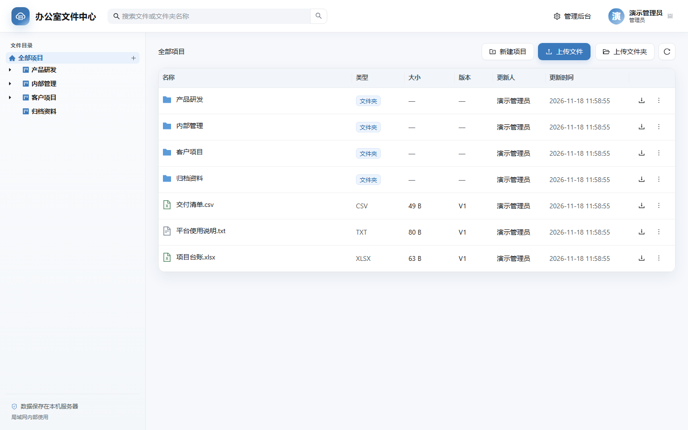
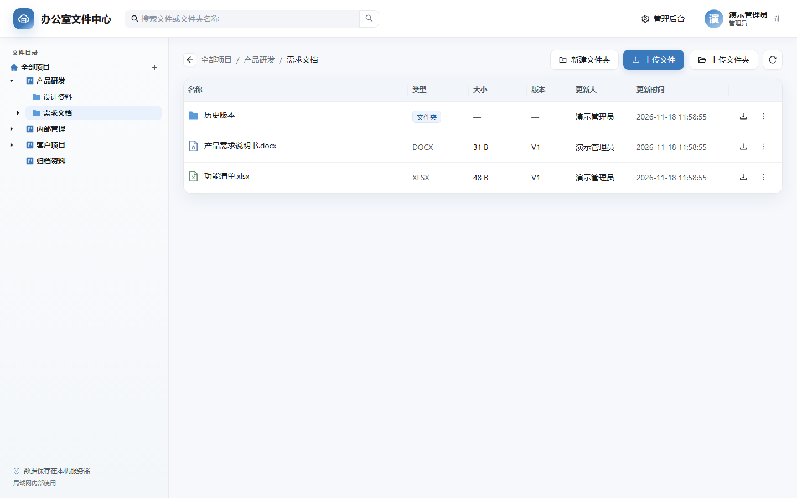
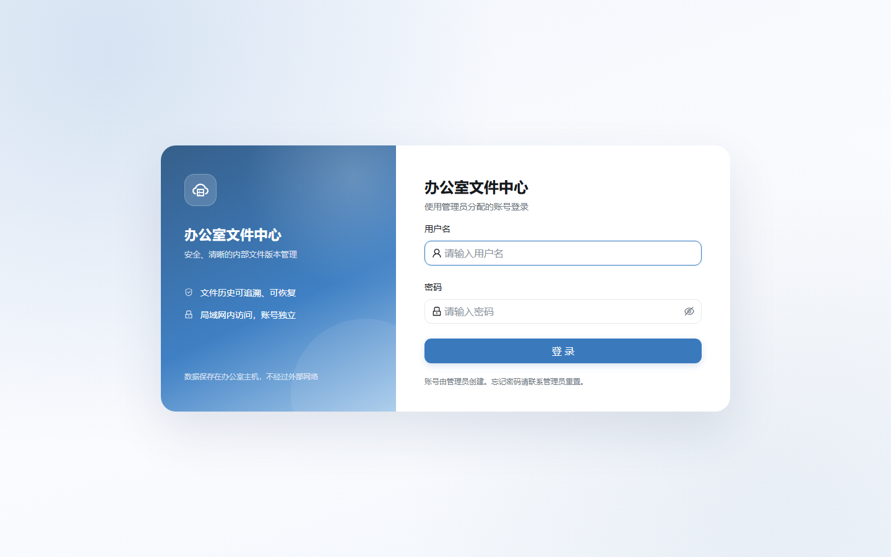

# 办公室文件中心（LanFilePlatform）

面向十几人办公室的局域网文件版本管理平台。文件集中保存在一台长期开机的 Windows 主机上，员工用 Edge 或 Chrome 浏览器访问，不需要安装客户端。

当前版本：**0.2.5**

## 界面预览

### 项目目录与主界面



### 文件列表与格式图标



### 登录页



> 截图使用虚构演示数据和“演示管理员”，不含真实账号姓名或内网地址。

## 员工端访问地址（必读）

员工电脑的浏览器地址必须填写**主机的局域网 IP 地址**，例如：

```text
https://192.168.1.100:9443/
```

- 把 `192.168.1.100` 换成文件主机的实际 IP，端口默认 `9443`。
- **不要填写 `localhost` 或 `127.0.0.1`**。这两个地址在员工电脑上指向员工自己的电脑，不是文件主机。
- 主机 IP 可在主机上执行 `ipconfig` 查看；建议在路由器中为主机设置固定 IP 或 DHCP 地址保留。
- 员工第一次访问前，需要先运行管理员提供的 `一键信任证书.cmd`，否则浏览器会提示证书不受信任。

## 功能

- 管理员创建账号，首次登录强制修改初始密码；忘记密码由管理员重置。
- 三种角色：管理员、编辑者、只读者；权限在服务端强制校验。
- 共享目录树、面包屑、按名称搜索、排序、文件大小和更新时间。
- 多文件上传、文件夹上传、拖拽上传、进度、取消和失败重试；同名文件可作为新版本或改名上传。
- 双击进入文件夹；文件直接下载，文件夹可打包为 ZIP 下载；文件行、目录树和空白区域支持右键菜单。
- 流式写盘，默认单文件上限 2 GB，可在管理后台调整。
- 历史版本：上传人、时间、大小、SHA-256；任意历史版本可下载或恢复为新版本。
- 版本冲突保护：多人基于旧版本同时更新时，后提交者会被拒绝并提示刷新。
- 删除进入回收站；管理员可恢复、永久清理或一键清空。
- 操作日志记录操作人、时间、文件路径、结果和来源 IP，支持筛选和 CSV 导出。
- 独立备份：数据库一致性快照和全部历史文件，自动或手动执行、逐对象校验、保留策略和恢复工具；每次备份另生成按原目录和文件名组织的可读副本。
- 自动生成本地根证书和服务器 HTTPS 证书；主机 IP 或名称变化时自动重签服务器证书。
- Windows 服务安装、卸载、防火墙和独立数据目录脚本。

## 技术结构

```text
员工浏览器（Edge / Chrome）
        │ HTTPS（局域网）
        ▼
LanFileServer.exe — Windows 服务
├── React + Ant Design 网页（内嵌）
├── HTTP API / 登录 / 审计
├── SQLite meta.db（WAL）
├── 不可变对象存储（历史版本内容）
└── 定时备份 ──► 独立磁盘 / 另一台电脑
```

- 后端：Go，标准库 HTTP，SQLite（modernc.org/sqlite，纯 Go，无需 CGO）。
- 前端：React 18、TypeScript、Ant Design 5、Vite。
- 密码：Argon2id；会话：HttpOnly 和 SameSite Cookie；写请求做同源校验。
- 单主机、单服务进程，适合十几人规模，不依赖 Docker、Python 或外部数据库。

## 目录

```text
cmd/server/              服务入口、Windows 服务、恢复命令
internal/api/            HTTP 路由、鉴权、上传下载、管理接口
internal/auth/           密码、会话、账号
internal/files/          目录、版本、冲突、回收站
internal/storage/        临时文件、不可变对象、磁盘空间
internal/audit/          审计记录与查询
internal/backup/         一致性备份、校验、恢复
internal/certsetup/      HTTPS 证书生成与检查
internal/db/             SQLite 迁移
internal/webui/          内嵌前端构建产物
web/                     前端源码
installer/               安装、卸载、证书信任、发布脚本
docs/                    管理员、员工、维护文档与更新日志
```

## 主机部署

1. 在 GitHub Releases 下载 `LanFilePlatform-0.2.5-public.zip`，解压到主机。
2. 双击 `安装.cmd`，按提示填写数据目录和端口。默认数据目录 `D:\LanFileData`，默认端口 `9443`。
3. 打开 `https://localhost:9443` 或 `https://<主机IP>:9443`，创建初始管理员。
4. 在「管理后台 → 备份与系统」配置独立备份目录，并做一次手动备份。
5. 把 `一键信任证书.cmd` 发给员工电脑；员工双击运行后，用 `https://<主机IP>:9443` 访问。

> 数据目录不要放在程序目录内；备份目录放在独立磁盘或另一台电脑，并给服务账号 `NT AUTHORITY\LocalService` 写权限。

## 员工使用

1. 双击 `一键信任证书.cmd`，等待窗口显示“证书链验证：通过”。
2. 用 Edge 或 Chrome 打开 `https://<主机IP>:9443`。地址必须填写主机的局域网 IP，不能填 `localhost` 或 `127.0.0.1`。
3. 输入管理员分配的账号和初始密码，首次登录按提示修改密码。
4. 上传文件或文件夹；同名文件选择“替换为新版本”或“改名上传”。
5. 需要旧版本时，打开文件详情，进入历史版本，下载或恢复。

## 升级

- 双击新版发布包中的 `安装.cmd` 即可覆盖升级。
- 安装时**必须沿用原数据目录和端口**（默认 `D:\LanFileData`、`9443`），否则会连接到空目录，看起来像数据丢失。
- 升级前建议在「管理后台 → 备份与系统」做一次手动备份，并保留旧发布包。
- 数据目录在程序目录之外，升级只替换程序文件，数据库迁移自动执行。

## 备份与恢复

- 每次成功备份包含 `meta.db`、`objects`、`manifest.json`、`complete.json`、`certs` 和 `files` 可读副本。
- `files` 按原目录和文件名保存当前版本，可直接在资源管理器中打开；历史版本仍在 `objects` 和 `meta.db`。
- 备份不包含程序 exe，请把发布包 ZIP 与备份一起保存。
- 恢复示例：

```powershell
LanFileServer.exe -restore "<备份目录>" -restore-to "D:\LanFileData-restored"
```

## 本地开发

要求：Go 1.22+、Node.js 18+。

```powershell
cd web
npm install
npm run build

cd ..
go run ./cmd/server -data D:\LanFilePlatformDev -addr :8080 -http
```

打开 `http://localhost:8080`，首次会要求在这台主机上创建管理员。

前端热更新开发：

```powershell
# 终端 1
go run ./cmd/server -data D:\LanFilePlatformDev -addr :8080 -http
# 终端 2
cd web
npm run dev
```

Vite 开发服务器会把 `/api` 代理到 `127.0.0.1:8080`。

测试与检查：

```powershell
go test ./...
cd web
npm run build
```

## 构建发布包

```powershell
powershell -ExecutionPolicy Bypass -File .\installer\build.ps1 -Version 0.2.5
```

输出：`release\LanFilePlatform-0.2.5.zip`。解压后在主机双击 `安装.cmd`。

> 构建脚本中的 `SERVER` 示例地址为 `https://192.168.1.100:9443`，发布前请改成主机实际 IP，或在生成的 `一键信任证书.cmd` 中传入服务器地址。

## 文档

- [管理员部署指南](docs/管理员部署指南.md)
- [员工使用说明](docs/员工使用说明.md)
- [架构与维护说明](docs/系统架构与维护.md)
- [验收记录](docs/验收记录.md)
- [更新日志](docs/更新日志.md)

## 已知边界

- 没有本地文件夹自动同步和 SVN 检出/提交工作流；修改文件后需要在网页上传新版本。
- 不支持断点续传；网络中断时需要重新上传该文件。默认主要面向 1 GB 以下文件。
- 不提供在线预览、在线编辑、全文检索或多人协作编辑。
- 第一版为全员共享目录，不提供按部门或项目的细粒度权限。
- 文件夹上传不包含空文件夹；搜索仅匹配文件和文件夹名称。
- 备份默认每日一次；主机在计划时间关机时当天不会自动补备份。
- 自动生成的本地根证书只适合内部局域网，不等同于公共 CA 证书。

## 数据安全

- 不要把 `objects`、`meta.db` 手工复制、移动或删除；所有文件操作请通过网页完成。
- 网页操作日志不是防篡改审计系统：拥有主机管理员权限的人仍可直接修改本地文件或数据库。
- 平台不替代杀毒软件；员工打开下载文件时仍由终端安全软件负责防护。
- 不要将服务端口映射到公网。默认防火墙规则只允许专用或域网络的本地子网访问。

## 说明

- 本仓库为公开版本，内网 IP、本机用户名和路径已脱敏；示例地址 `192.168.1.100` 仅用于说明，请替换为主机实际 IP。
- 含真实账号姓名的界面截图和 Word 手册未上传到公开仓库。
- 当前版本 0.2.5，发布包和可执行文件见 GitHub Releases。
